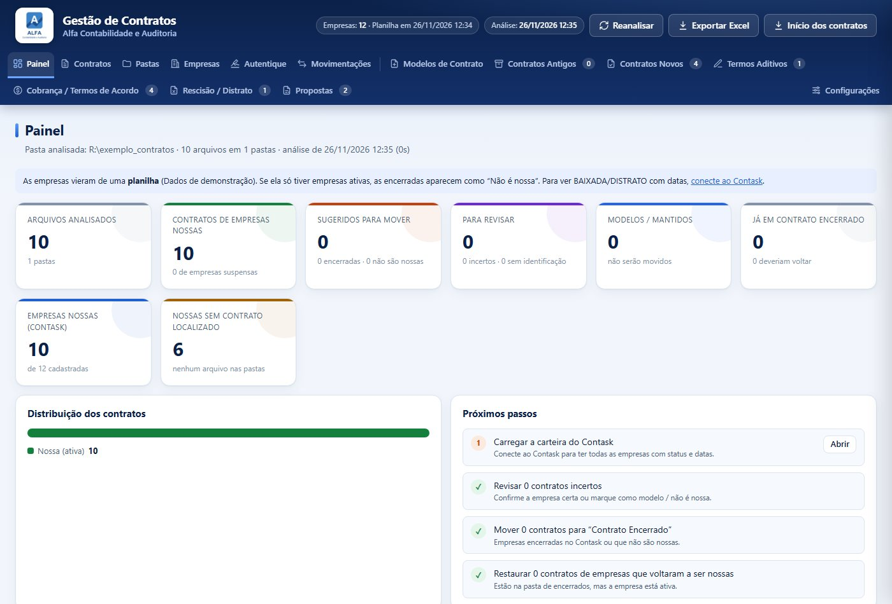
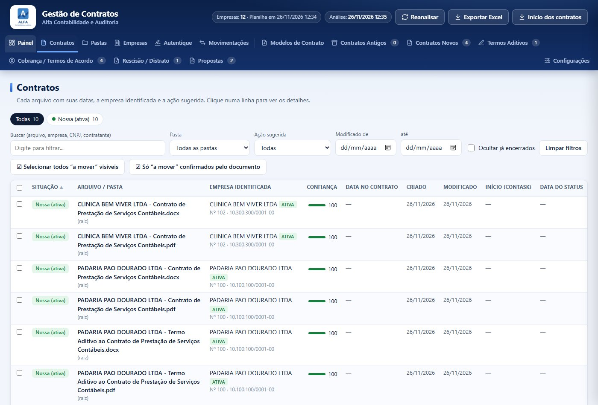

# Sistema de Gestão de Contratos

Sistema web para escritórios de contabilidade. Ele **gera, organiza e acompanha** contratos, propostas comerciais e documentos de cobrança. Os documentos saem prontos em **Word e PDF**, no padrão visual do escritório, e a carteira de clientes fica num painel único.

> \*\*Versão de demonstração.\*\* O sistema original está em uso num escritório de contabilidade. Nesta versão, a empresa ("Alfa Contabilidade e Auditoria"), as pessoas, os CNPJs e os endereços são \*\*fictícios\*\*.

## O problema

O escritório guardava centenas de contratos em pastas de rede, com nomes de arquivo sem padrão. Cada documento era redigido à mão, copiando um contrato antigo. Ninguém sabia com facilidade quais clientes ativos estavam sem contrato, nem em que etapa estava a cobrança de cada inadimplente.

## O que o sistema faz

* **Análise da pasta de contratos:** lê os arquivos Word e PDF, identifica a empresa de cada um (por CNPJ ou por semelhança de nome) e cruza com a carteira de clientes. Aponta clientes sem contrato, contratos de empresas encerradas e arquivos a revisar.
* **Geração de documentos por modelos:** contrato de prestação de serviços contábeis, contrato de locação de endereço fiscal, termo aditivo, distrato e notificação de rescisão.
* **Propostas comerciais** (Auditoria, Lucro Presumido, Diagnóstico Fiscal e Simples Nacional), com numeração sequencial por ano e cálculo automático de horas, valores e parcelas.
* **Fluxo de cobrança em quatro etapas:**

  1. notificação de débito;
  2. suspensão dos serviços;
  3. notificação extrajudicial;
  4. termo de acordo, com o cronograma de parcelas calculado automaticamente.

  Cada cliente aparece com a etapa em que está, o prazo de resposta e o botão do próximo passo, que já vem preenchido com os dados do documento anterior.

* **Editor de modelos:** os textos dos documentos ficam em arquivos JSON com uma marcação simples (`{{CAMPO}}`, `\*\*negrito\*\*`, `## Seção`, parágrafos opcionais) e podem ser editados pela própria interface, com prévia ao vivo.
* **Valores por extenso, datas e CNPJ** formatados automaticamente (ex.: `R$ 6.634,97 (seis mil, seiscentos e trinta e quatro reais e noventa e sete centavos)`).
* **Integrações:** consulta de CNPJ em API pública, sincronização da carteira com o sistema interno do escritório e acompanhamento de assinaturas eletrônicas no Autentique.
* **Uso em rede:** um computador roda o servidor e os demais acessam pelo navegador.

## Telas

> Capturas da versão de demonstração, com dados fictícios.

**Painel** — resumo da análise da pasta de contratos e próximos passos



**Contratos** — cada arquivo com a empresa identificada, a confiança e as datas



**Cobrança / Termos de Acordo** — fluxo de cobrança em quatro etapas e acompanhamento por cliente


**Propostas** — modelos de proposta comercial e propostas emitidas


## Tecnologias

|Camada|Tecnologia|
|-|-|
|Servidor|Python 3 (`http.server`, sem frameworks)|
|Interface|HTML, CSS e JavaScript puro (sem frameworks), com tema claro e escuro|
|Word (.docx)|Gerado do zero em OpenXML (XML + ZIP), sem bibliotecas externas|
|PDF|HTML próprio para impressão, convertido pelo Edge/Chrome em modo *headless*|
|Dados|Arquivos JSON locais, com gravação segura entre usuários|

A geração de Word e PDF não depende de bibliotecas externas: o sistema monta o documento (cabeçalho com logo, rodapé com endereços e número de página, quadro de assinaturas e tabelas) diretamente no formato OpenXML.

## Como rodar

Requisitos: **Python 3.10+** e **Microsoft Edge** ou **Google Chrome** (para gerar os PDFs).

```bash
python gerar\_exemplos.py
python servidor.py
```

O primeiro comando cria 12 empresas fictícias e 17 documentos de exemplo. O segundo inicia o servidor e abre o navegador em `http://127.0.0.1:8765`. No Windows, também dá para abrir pelo `Iniciar Sistema.bat`.

Bibliotecas opcionais, para ler contratos em PDF e trabalhar com planilhas:

```bash
pip install -r requirements.txt
```

## Estrutura

```
servidor.py            servidor HTTP e API (rotas /api/...)
nucleo/
  modelos.py           motor de modelos: campos, cálculos, geração de Word e PDF
  analise.py           análise da pasta de contratos
  extrator.py          leitura de texto e CNPJs de arquivos Word e PDF
  identificador.py     identificação da empresa pelo nome do arquivo (semelhança de texto)
  empresas.py          carteira de clientes (API do sistema interno ou planilha)
  autentique.py        integração com o Autentique (assinatura eletrônica)
  cnpj.py              consulta de CNPJ
  movimentacao.py      organização de arquivos entre pastas, com histórico e "desfazer"
web/                   interface (index.html, app.js, estilo.css)
dados/modelos/         textos dos documentos (JSON), logo e selo do rodapé
gerar\_exemplos.py      cria os dados de demonstração
```

## Autor

Desenvolvido por Yan pablo machado costa.

## Licença

Distribuído sob a licença MIT. Veja o arquivo [LICENSE](LICENSE).
